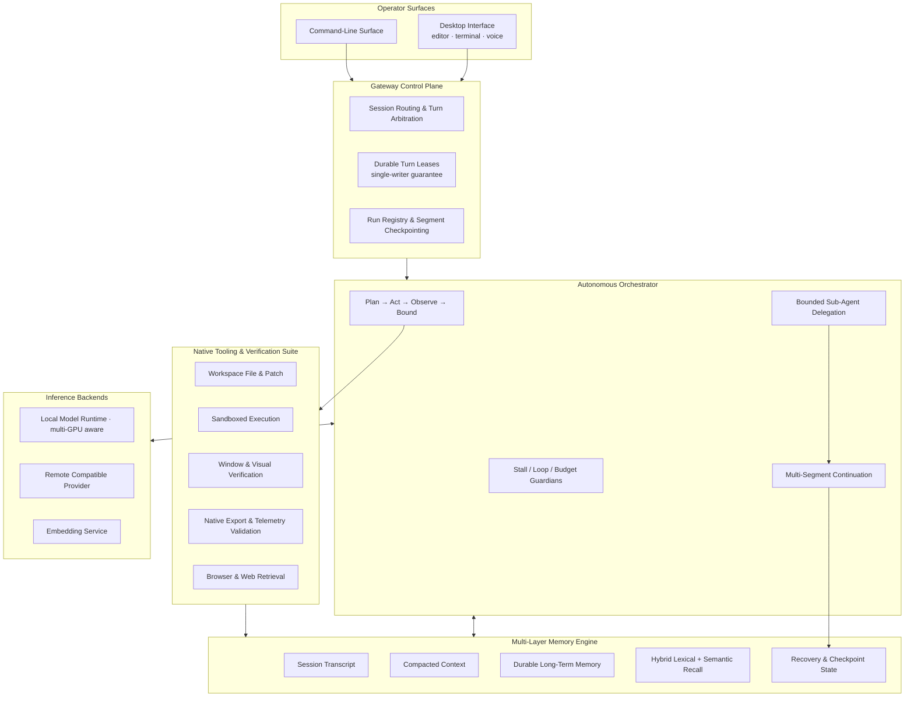

# ⧗ CHRONOS

**A closed-source, local-first autonomous AI engineering & desktop orchestration platform.**

*Plans multi-step engineering work · edits live code · runs and verifies what it built · remembers what it learned across sessions · resumes cleanly after a crash — entirely on your own hardware.*

> **⚠ PROPRIETARY / CLOSED SOURCE.** CHRONOS is closed-source, proprietary software. All source code, algorithms, orchestration heuristics, prompt and persona materials, model-routing logic, retrieval-ranking strategy, verification tooling, and configuration assets are the confidential intellectual property of the project owner. This repository is provided for reference and grants no license to the underlying implementation.

---

## 1. What CHRONOS Is

CHRONOS is a **persistent, self-directed technical collaborator** that runs entirely on the operator's own hardware.

It is not a chat assistant with a code window attached to it — it is an execution platform with an agent in the middle of it. Hand it an engineering objective and it will decompose the objective, gather the context it needs, apply real edits to your workspace, execute the result, inspect what actually happened, correct itself, and keep going across many bounded work segments until the objective is met — or until it can state precisely which quality gate it could not clear, and why.

It is built around four convictions:

| Conviction | What it means in practice |
| --- | --- |
| **Autonomy must be bounded, not unlimited** | Every action runs inside iteration caps, per-operation timeouts and wall-clock turn budgets. An agent that runs indefinitely is not reliable; an agent that stops at observable, provable limits is. |
| **Memory is a substrate, not a feature** | Session transcripts, compressed context, durable facts, archival search and crash-recovery state form a layered persistence stack — not a single scrollback buffer. |
| **Verification is part of generation** | An engineering claim is not complete when the model asserts it. It is complete when it has been exercised against reality through defined gates. |
| **Local-first is a hard constraint** | State, retrieval, embeddings, voice and execution run on your machine. Remote inference is an optional, explicitly configured capability — never a dependency. |

---

## 2. What CHRONOS Can Do

### 2.1 Run long, autonomous engineering sessions
- **Plan → act → observe → decide** loops under hard iteration, timeout and wall-clock bounds.
- **Multi-segment continuation** — when a segment ends on a budget rather than on completion, the engine autonomously opens the next segment against the same persisted state and continues. This yields coherent multi-hour sessions without weakening any safety bound, because each segment stays independently bounded, checkpointed and cancellable.
- **Stall-loop prevention** — detects repetitive tool-call patterns, near-identical consecutive responses, provider streams that stop producing output, and delegation cycles that fail to advance state. Each maps to a distinct named terminal condition, so *why the work stopped* is always knowable after the fact.
- **Graceful recovery** — run state, segment boundaries and turn authority persist transactionally, so a run interrupted by cancellation, process termination or system crash resumes from a deterministic checkpoint rather than from the beginning or from a half-written state.
- **Mid-run cancellation** honored at execution checkpoints, not merely between turns.
- **Liveness and streaming progress** — in-flight activity is visible as it happens, not only at completion.

### 2.2 Delegate bounded sub-work
- Spawns isolated child runs, each with its own queryable transcript, restricted capability allowlist, own system framing and own budget.
- Delegation depth is finite and enforced structurally: children at maximum depth are simply never granted the ability to delegate further, so delegation trees always terminate.
- Every delegation lands in a durable parent→child ledger recording budget consumed and final outcome.

### 2.3 Edit your workspace live — without wrecking it
- Live structural view of the active project, streamed to the interface as it changes.
- Real-time streaming of edits into an embedded code editor — continuous visibility rather than a post-hoc diff.
- Changes applied as targeted, validated patches wherever possible, preserving your authored content, unsaved buffers and editor undo history.
- Atomic writes, so an interrupted edit cannot leave a truncated file.
- Embedded interactive terminal — a real pseudo-terminal session synchronised to the active workspace root, so you can run builds and probe state in the same context the agent occupies.
- Exactly one project root is active at a time, chosen by you and persisted; all file traversal is confined to it structurally, not by string heuristics.
- High-consequence operations surface for explicit approval. Human-in-the-loop authority is retained throughout.

### 2.4 Remember across sessions
- Durable, append-only session transcripts that survive process exit and remain the authoritative record.
- Automatic context compaction past a high-water mark into a dense structured synopsis — while the summarised turns are preserved and remain searchable, never deleted.
- Scoped long-term memory for facts and learnings that outlive any single session, deduplicated at write time by semantic similarity so the store converges instead of accumulating near-duplicates.
- **Hybrid recall** — lexical full-text ranking fused with vector-similarity ranking into a single relevance order, so a session from months ago surfaces from either an exact token or a conceptual paraphrase. Fusion depth and candidate breadth are operator-tunable.
- **Safe degradation** — if the embedding backend is unreachable, writes fall back to lexical-only indexing without error, and a background reconciliation pass backfills the semantic gap automatically once the backend returns. An agent turn never fails because an embedding service is down.

### 2.5 Talk to it, and listen back
- Fully local speech input: energy-plus-model voice-activity gating, streaming recognition in an isolated worker process with quantised inference, and model pre-warming so the first interaction is never the slow one.
- An engineering-aware domain prompt materially improves recognition of technical vocabulary.
- An explicit *listen → think → speak* state machine: microphone ingestion is suppressed while CHRONOS is reasoning or speaking, so it never interrupts itself and produces no feedback artefacts.
- Sentence-level streamed text-to-speech, so speech begins before a full response exists, backed by an audio buffer-health monitor that keeps playback from under-running or over-running the output device.
- Live screen and window capture as a first-class visual observation channel.

### 2.6 Use your hardware efficiently
- Multi-GPU aware: speech, embedding and inference workloads can be pinned to specific accelerator devices independently, keeping heavy interactive work off the primary compute path.
- Every accelerator path degrades automatically to a quantised CPU path when no suitable device is present, so the platform stays fully functional on modest hardware instead of failing to start.
- Interchangeable inference backends — fully local, self-hosted and remote-compatible — treated as first-class peers, with behaviour validated across all three so capabilities do not silently differ by runtime.

### 2.7 Orchestrate the desktop, not just files
- Inspects and verifies live window state: whether an application survives several seconds of real execution, owns a correctly sized top-level window with the expected identity, and is not an error dialog masquerading as the application.
- Automated browser interaction and web retrieval as observation channels.
- Sandboxed command execution under an explicit policy layer, with critical system processes protected against agent-initiated termination.

### 2.8 Automate and schedule
- Persistent scheduled and automated tasks dispatched by the control plane with durable run state.
- Runtime configuration adjustable live, without dropping active sessions or losing state.
- Interface preferences persist durably and replay on startup, so the environment you configured is the environment that returns after a restart.

---

## 3. How It Is Put Together

**The defining structural property is a single long-lived control plane** to which every operator surface attaches as a thin client. Because authority to act on a session is arbitrated centrally through durable leases, multiple surfaces can watch the same conversation concurrently while only one writer can ever drive it — eliminating duplicate or contradictory responses, and letting a dead process's held authority be reclaimed automatically through lease expiry so the system cannot wedge itself into an unresponsive session.

---

## 4. The Verification Discipline

CHRONOS encodes an explicit **pre-completion verification discipline**: an engineering task is not complete when the model says it is complete. It is complete when five independent gates pass — or when it states precisely which gate it could not satisfy and why.

| # | Gate | What it catches |
| --- | --- | --- |
| 1 | **Live target execution** | The real production path must be exercised end-to-end. Mocked, demo-mode or simulation-only confirmation does not count as completion for anything meant to run for real. |
| 2 | **Native interface & export validation** | Bound entry points verified to exist verbatim in the actual binary's export surface, with signatures, layouts, widths and constants grounded against authoritative definitions rather than recalled. Catches the failure class invisible to a compiler: bindings that look right and are wrong. |
| 3 | **Value sanity & ground-truth cross-checking** | Reported telemetry compared field-by-field against authoritative system tooling, with unavailable-value sentinels, impossible magnitudes and self-contradictory states caught by automated assertion — so a sentinel can never be rendered as a plausible number. |
| 4 | **Visual & window-state inspection** | Survives real seconds of execution, owns a visible correctly sized window, is not an error dialog, and then a live capture is visually inspected for layout integrity, clipped content and collapsed regions. |
| 5 | **Workspace hygiene** | Probes, scratch scripts and verification captures confined to isolated temporary locations and removed before handoff, with the version-control working tree audited at the end so every remaining change is an intended deliverable. |

The architectural significance is that quality standards are **externalised into executable checks** rather than left in prose. The same tools used to build are the tools used to prove the build is correct.

---

## 5. The Memory Model

| Tier | Role | Retention behaviour |
| --- | --- | --- |
| **1 · Session transcript** | Append-only record of everything that happened | Never lost to process exit; authoritative source of record |
| **2 · Compacted context** | Dense synopsis replacing older turns past a high-water mark | Older turns leave the active window but stay fully archived and searchable |
| **3 · Durable long-term memory** | Explicitly persisted facts and learnings | Outlives any session; deduplicated on write by semantic similarity |
| **4 · Hybrid recall** | Unified retrieval across archive and durable memory | Fuses lexical and vector ranking into one relevance order |
| **5 · Recovery & checkpoint state** | Leases, run/segment checkpoints, liveness, delegation ledger | Guarantees crash-consistent resumption and single-writer integrity |

Compaction is **lossless at the archive level**: the model works from a dense synopsis while you and the retrieval layer still hold the complete record.

---

## 6. Security, Privacy & Local-First Guarantees

- **Local-first state.** All conversation history, durable memory, embeddings, run checkpoints, schedules and task state persist in transactional stores on your machine. No external cloud database, and no telemetry pipeline carrying workspace content off-box.
- **Loopback confinement.** The control plane and workspace service bind to the local machine only and are not network-reachable. Access is gated by a shared secret enforced on every request and compared in constant time to resist timing side channels.
- **Origin allowlisting.** Browser-facing origins are strictly allowlisted to local application contexts, so a remote or arbitrary web page cannot drive the local control surface even while you browse.
- **Sandboxed execution.** File capabilities operate inside an enforced path sandbox anchored to your chosen root; command execution sits behind an explicit policy layer.
- **Injection-resistant context.** Tool output passes through a sanitization stage before entering model context, limiting indirect prompt-injection and control-character abuse from retrieved files or fetched pages.
- **Bounded blast radius.** Permission tiers, iteration caps, timeouts and delegation-depth limits are enforced in the execution engine itself, so they hold regardless of what the model attempts.
- **Declared permission tiers.** Every capability is classified by consequence level — read, write, execute — with the highest tier governed by explicit configuration. Classification is a property of the capability declaration, not an inference made at call time.
- **Process isolation.** Speech recognition, native execution, terminal sessions and browser automation run in separate worker or pseudo-terminal contexts, so their failure degrades a single capability instead of terminating the platform.
- **Auditable by construction.** Orchestration decisions, tool invocations, delegations and compactions all emit structured records carrying trace, session and turn correlation identifiers — so what the agent did, and why it stopped, is reconstructable after the fact without runtime instrumentation.
- **Testable without exposure.** The verification suite operates hermetically with deterministic scripted backends, exercising routing, handoff, error and budget behaviour without outbound network calls or live credentials.

---

## 7. Extensibility

- **A validated capability registry, not a hard-coded tool set.** Every capability is schema-described and parameter-validated before execution; malformed calls are rejected before they can touch the system, and every invocation is logged with correlation identity.
- **Portable skill bundles.** Domain expertise ships as declarative, self-describing instruction bundles — organised by category with reference and template material — discovered and loaded without code changes. Capability extends without redeploying the engine.
- **Standard external tool bridging.** Third-party tool servers attach over an established open protocol and integrate through the same registry, permission and validation discipline as native capability.

---

## 8. Interface Surfaces

| Surface | Purpose |
| --- | --- |
| **Desktop interface** | Native shell with embedded code editor, live workspace tree, interactive terminal, voice input/output and visual inspection |
| **Command-line surface** | Interactive and one-shot operation against the same control plane and the same durable state |
| **Gateway control plane** | Long-lived host process arbitrates every session, holds all durable state, and dispatches scheduled work |

All surfaces share one body of state. A task started from the command line is observable from the desktop interface, and vice versa.

---

## 9. Operational Characteristics

| Dimension | Stance |
| --- | --- |
| **State durability** | No critical state lives only in process memory; everything commits to a transactional embedded store with write-ahead durability |
| **Concurrency** | Single-writer per session by construction; unlimited concurrent observers |
| **Interruptibility** | Cancel honored at execution checkpoints; interruption is a normal, recoverable path |
| **Failure posture** | Per-subsystem degradation preferred over platform termination; accelerator features fall back to CPU rather than failing to start |
| **Observability** | Structured, correlation-identified audit records for every orchestration decision and tool invocation |
| **Inference coupling** | Provider-agnostic; local, self-hosted and remote backends interchangeable |

---

## 10. Classification

CHRONOS is **closed-source, proprietary software**. This document describes *what the system does and why it is designed that way*, never *how it is implemented*. It intentionally contains no source code, no internal module or symbol names, no database schemas, no prompt or persona text, no wire-protocol identifiers, and no configuration values.

Reproduction, reverse engineering, decompilation, or derivation of implementation details from this document or from distributed binaries is prohibited. All rights reserved.

---

**CHRONOS** — *state must survive, execution must be bounded, claims must be verified.*

Made with intention. Los Angeles, CA.
